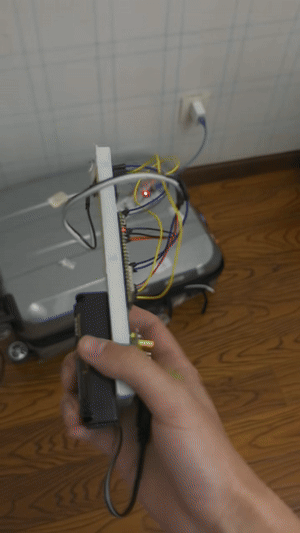

# ESP32 Smart Wand: On-Device Gesture Recognition with TinyML

[](https://github.com/a0930928334-jpg/esp32-tinyml-smart-wand/actions/workflows/host-tests.yml)

A handheld wand that recognises gestures on an ESP32-S3 and controls a model house over infrared. An MPU6050 IMU is sampled every 10 ms, an Edge Impulse classifier runs on the microcontroller, and a small state machine turns five gesture classes into six commands. An Arduino Nano receives the commands and drives an LED and two servos that stand in for a light, a door and a curtain.

This was my undergraduate final-year project (Zhejiang Gongshang University, 2026). The house is a model: nothing here switches mains-powered equipment.



## At a glance

| | |
|---|---|
| On-device inference | ~1 ms per window on the ESP32-S3 |
| Model footprint | ~1.6 KB peak RAM, ~16.9 KB flash |
| Validation accuracy | 95.8% (Edge Impulse validation set) |
| Physical tests | ~90% single gesture, ~85% two-step command, ~89% infrared delivery |
| Commands | 6, built from 5 gesture classes |
| Host unit tests | 56 checks on the decision logic, run in CI with GCC and Clang |

Validation accuracy and physical results measure different things; [docs/testing.md](docs/testing.md) explains the gap.

## How it works

```text
MPU6050 (6-axis, 10 ms)  ->  sliding window  ->  wake-up gate (peak |a| >= 13 m/s^2)
        ->  Edge Impulse classifier (every 5th sample)
        ->  confidence, noise and physical checks
        ->  command state machine  ->  32-bit NEC infrared  ->  Nano receiver
```

The model's top score is not trusted on its own. A window is accepted only if the best class scores above 0.80, the noise class scores below 0.75, and, for the two prefix gestures, the motion also looks physically right (enough Y-axis force and estimated travel). Those extra checks were added because the model sometimes read other movements as a thrust or a swing.

Two of the gestures act as prefixes, so four gestures give six commands:

| First gesture | Then | Command |
|---|---|---|
| | Circle | Light on |
| | Z | Light off |
| Upward swing | Circle | Curtain open |
| Upward swing | Z | Curtain close |
| Forward thrust | Circle | Door open |
| Forward thrust | Z | Door close |

A prefix is forgotten after 5 seconds. The fifth class is "noise" and never triggers anything.

## Repository layout

```text
firmware/
  common/            ir_codes.h, timing.h: shared by both boards
  wand-esp32s3/      sensing, inference, gesture logic, infrared sender
  receiver-nano/     infrared decoding, LED and servo control
tests/               host unit tests for the decision logic
docs/                architecture, hardware, model, testing, limitations, engineering notes
```

## Build and test

```bash
make -C tests                                    # unit tests on a PC, no hardware needed
cd firmware/wand-esp32s3 && pio run -t upload     # needs the Edge Impulse library, see its README
cd firmware/receiver-nano && pio run -t upload
```

The trained model is not committed to git. Download the Edge Impulse export (`ei-smartwand2-arduino-1.0.2-impulse-#1.zip`) from the [Releases page](https://github.com/a0930928334-jpg/esp32-tinyml-smart-wand/releases) and unzip it into `firmware/wand-esp32s3/lib/SmartWand2_inferencing/`; [firmware/wand-esp32s3/README.md](firmware/wand-esp32s3/README.md) has the details.

## Where to look first

- [docs/engineering-notes.md](docs/engineering-notes.md): issues found in a code review after submission (a timer overflow that would freeze the wand after about 71 minutes, and an infrared bit-order mismatch that the servo wiring had been hiding), and how each fix is tested.
- [firmware/wand-esp32s3/src/gesture_logic.h](firmware/wand-esp32s3/src/gesture_logic.h): the decision logic, kept free of Arduino code so it can be tested on a PC.
- [docs/testing.md](docs/testing.md) and [docs/limitations.md](docs/limitations.md): what was measured, and what the prototype cannot do.

## Further reading

[Architecture](docs/architecture.md) · [Hardware](docs/hardware.md) · [Model](docs/model.md) · [Testing](docs/testing.md) · [Limitations](docs/limitations.md) · [Engineering notes](docs/engineering-notes.md)
